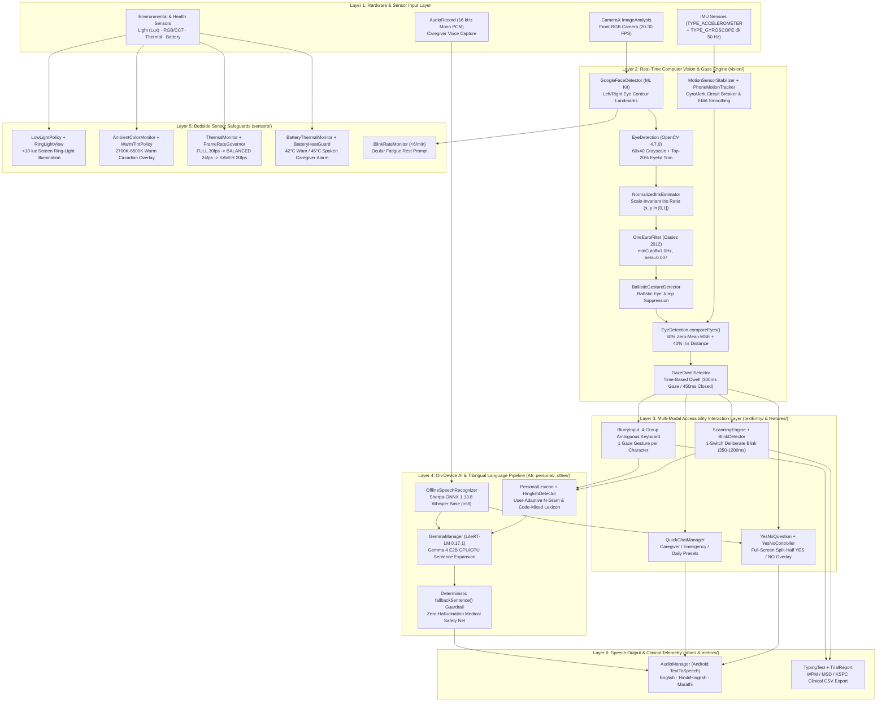

# VAKYAM (वाक्यम्) — Technical Design Document (TDD)

**Project Title:** Vakyam — Offline On-Device Eye-Tracking & Edge-AI AAC Voice System for Speech/Motor-Impaired Patients  
**Hackathon Track:** Hack for Social Cause (VBYLD 2027 · Ministry of Youth Affairs & Sports · Knowledge Partner: IIT Bombay)  
**Team Name:** Kautilya (`HSC|MH|00223`)  
**Institution:** Pune Institute of Computer Technology (PICT), Pune, Maharashtra  
**Authors:** Srujan Satav (Team Lead), Harshad Dhavane, Mridul Bansal  
**Website:** [https://vakyam.duckdns.org/](https://vakyam.duckdns.org/)  
**Demo Video (Product Walkthrough):** [https://www.youtube.com/watch?v=-g4dIs63R34](https://www.youtube.com/watch?v=-g4dIs63R34)  
**Clinical Validation Video (ALS Patient Trial):** [https://www.youtube.com/shorts/Bg2RnMts7lc](https://www.youtube.com/shorts/Bg2RnMts7lc)  
**Repository:** [https://github.com/harshadd-ops/Vakyam](https://github.com/harshadd-ops/Vakyam)  
**License:** MIT License ([`LICENSE`](LICENSE))  

---

## 1. Executive Summary & System Objectives

Across India, over **20 Lakh (2 million) citizens**—and **2 Lakh+ in Maharashtra alone**—live with severe speech and motor impairment caused by post-stroke aphasia, Amyotrophic Lateral Sclerosis (ALS / Motor Neurone Disease), brainstem stroke (locked-in syndrome), Parkinson's disease, cerebral palsy, traumatic brain injury (TBI), or post-surgical head-and-neck/oral cancer tracheostomies. While their cognitive faculties and ocular muscles remain intact, dedicated infrared (IR) eye-tracking Augmentative and Alternative Communication (AAC) hardware (e.g., Tobii Dynavox) costs **₹2,50,000 to ₹8,00,000+**, requires rigid wheelchair mounts, relies on cloud connectivity, and lacks Indian regional language or Hinglish support.

**Vakyam** eliminates this ₹3 Lakh+ hardware barrier by transforming any commodity **₹10,000+ Android 8.0+ (API 26+) smartphone** with a standard RGB front camera into a **100% offline, medical-grade eye-controlled AAC voice system** supporting **English, Hindi/Hinglish, and Marathi**.

### Core Engineering Design Constraints
1. **Zero External Hardware:** Operates strictly on standard RGB front cameras (720p/1080p at 20–30 fps) without infrared LEDs or head mounts.
2. **100% Air-Gapped Offline Execution:** Zero cloud calls, zero network latency, and full compliance with India's **Digital Personal Data Protection (DPDP) Act 2023** and **Rights of Persons with Disabilities (RPwD) Act 2016**.
3. **Real-Time Edge Inference (`< 33 ms` Vision / `~1.36 s` LLM):** Frame-level gaze classification within a single 30 fps frame budget and sub-1.5-second abbreviated-keyword-to-sentence expansion via **Google LiteRT-LM (`0.17.1`, Gemma 4 E2B)**.
4. **Ward & Home Resilience:** Engineered to survive hand-held caregiver tremor, moving wheelchairs, dark hospital wards (`< 10 lux`), fluorescent ceiling glare, and 24×7 bedside charger heat.

---

## 2. High-Level System Architecture & Architectural Diagrams

Vakyam is architected as a modular, multi-threaded native Android application (`applicationId: com.vakyam.app`, source package `com.demo.opencv`) divided into **six decoupled layers**:

### 2.1 End-to-End Subsystem Mermaid Architecture



### 2.2 ASCII Architectural Data-Flow Diagram

```text
+---------------------------------------------------------------------------------------------------+
|                             VAKYAM ON-DEVICE RUNTIME (com.vakyam.app)                             |
+---------------------------------------------------------------------------------------------------+
|                                                                                                   |
|  [Front RGB Camera 30fps] ---> [GoogleFaceDetector] ----> [EyeDetection 60x40 Crop (-20% Top)]    |
|                                                                      |                            |
|  [IMU Accel + Gyro 50Hz] ----> [MotionSensorStabilizer]              v                            |
|         |                       (Jerk >3.5m/s^2 Pause)    [NormalizedIrisEstimator (x,y in 0..1)] |
|         v                                 |                          |                            |
|  [PhoneMotionTracker]                     |                          v                            |
|  (Tilt Drift Warning)                     |               [OneEuroFilter (Adaptive Low-Pass)]     |
|                                           |                          |                            |
|                                           |                          v                            |
|                                           +-------------> [BallisticGestureDetector]              |
|                                                                      |                            |
|                                                                      v                            |
|                                                           [Dual-Metric Gaze Classifier]           |
|                                                           (0.60 * ZeroMeanMSE + 0.40 * IrisDist)  |
|                                                                      |                            |
|                                                                      v                            |
|                                                           [GazeDwellSelector (300ms / 450ms)]     |
|                                                                      |                            |
|        +-------------------------------------------------------------+--------------------+       |
|        |                                     |                                            |       |
|        v                                     v                                            v       |
|  [BlurryInput: 4-Group Keyboard]   [ScanningEngine + BlinkDetector]    [Caregiver Audio 16kHz PCM]|
|  (1 Gesture/Char -> Bigram Match)  (350-1200ms Blink Row/Col)                     |               |
|        |                                     |                                    v               |
|        +------------------+------------------+                       [OfflineSpeechRecognizer]    |
|                           |                                          (Sherpa-ONNX Whisper int8)   |
|                           v                                                       |               |
|             [PersonalLexicon + HinglishDetector] <------------------ [YesNoQuestion Detector]     |
|                           |                                          (Full-Screen YES/NO Split)   |
|                           v                                                                       |
|             [GemmaManager: LiteRT-LM 0.17.1 Gemma 4 E2B (GPU/CPU)]                                |
|             (Expands Keywords + Caregiver Context in ~1.36s)                                      |
|                           |                                                                       |
|                           v                                                                       |
|             [Deterministic fallbackSentence() Guardrail] ---> [AudioManager TTS: EN / HI / MR]    |
+---------------------------------------------------------------------------------------------------+
```

---

## 3. Detailed Subsystem Specifications

### 3.1 Computer Vision & Gaze Estimation Pipeline ([`app/src/main/java/com/demo/opencv/vision/`](app/src/main/java/com/demo/opencv/vision))

Standard mobile gaze trackers fail in Indian clinical and home settings due to variable ambient lighting, camera auto-exposure shifts, head movement on pillows, and drooping upper eyelids (ptosis). Vakyam solves this through a **seven-stage hybrid geometric-template pipeline**:

1. **Eye ROI Extraction ([`GoogleFaceDetector.java`](app/src/main/java/com/demo/opencv/vision/GoogleFaceDetector.java) & [`EyeDetection.java`](app/src/main/java/com/demo/opencv/vision/EyeDetection.java))**:
   - Uses Google ML Kit Face Detection (`CONTOUR_MODE_ALL`) to extract the 16-point contours of the left and right eyes (`FaceContour.LEFT_EYE`, `FaceContour.RIGHT_EYE`).
   - Computes a padded bounding box and resizes each eye crop to a canonical **`60 × 40` grayscale OpenCV `Mat`**.
   - **Upper-Eyelid Trim (`20%`):** Automatically crops the top 8 rows (`20%`) of the eye patch to eliminate dynamic upper-eyelid shadow and eyelashes—the primary source of vertical gaze misclassification.
2. **Scale-Invariant Iris Ratio ([`NormalizedIrisEstimator.kt`](app/src/main/java/com/demo/opencv/vision/NormalizedIrisEstimator.kt))**:
   - Locates the darkest pupil/iris centroid via Gaussian smoothing + darkest-pixel neighborhood average inside the central vertical band.
   - Projects the iris center onto the vector connecting the inner and outer eye corners to output normalized ratios $(r_x, r_y) \in [0, 1]^2$, invariant to camera-to-face distance (30 cm to 75 cm).
3. **Adaptive Low-Pass Filtering ([`OneEuroFilter.kt`](app/src/main/java/com/demo/opencv/vision/OneEuroFilter.kt))**:
   - Applies Casiez et al.'s `1€ Filter` ($\text{minCutoff} = 1.0\text{ Hz}$, $\beta = 0.007$, $d_{\text{cutoff}} = 1.0\text{ Hz}$) to the raw eye coordinates:
     $$\alpha(\Delta t, f_c) = \frac{1}{1 + \frac{1}{2\pi f_c \Delta t}}, \quad f_c = f_{\min} + \beta \cdot |\dot{\hat{x}}|$$
   - Eliminates landmark jitter during fixation while introducing near-zero lag during intentional gaze shifts.
4. **Ballistic Saccade & Return Suppression ([`BallisticGestureDetector.kt`](app/src/main/java/com/demo/opencv/vision/BallisticGestureDetector.kt))**:
   - Monitors instantaneous eye-landmark velocity and return-to-center trajectories so intermediate gaze directions and return saccades are never falsely triggered.
5. **Hands-Free Calibration & Duplicate Template Check ([`CalibrationStabilityGate.kt`](app/src/main/java/com/demo/opencv/vision/CalibrationStabilityGate.kt) & [`CalibrationTemplateCheck.kt`](app/src/main/java/com/demo/opencv/vision/CalibrationTemplateCheck.kt))**:
   - During the 6-point calibration (`straight`, `left`, `right`, `up`, `left-up`, `right-up`), `CalibrationStabilityGate` waits for a `700 ms` settle + `400 ms` steady fixation while subtracting gyro-explained movement.
   - `CalibrationTemplateCheck` rejects any captured template that is too close to an earlier direction, preventing invalid calibration states.
6. **Illumination-Invariant Dual-Metric Classification ([`EyeDetection.java`](app/src/main/java/com/demo/opencv/vision/EyeDetection.java) & [`Model.java`](app/src/main/java/com/demo/opencv/vision/Model.java))**:
   - At runtime, each live eye patch $I$ and calibration template $T_d$ have their mean pixel intensity subtracted before computing Mean Squared Error (MSE), making matching invariant to uniform brightness shifts:
     $$\text{MSE}_0(I, T_d) = \frac{1}{N}\sum_{i=1}^{N} \left((I_i - \bar{I}) - (T_{d,i} - \bar{T}_d)\right)^2$$
   - The final distance combines **60% zero-mean pixel MSE** with **40% normalized iris-ratio distance**:
     $$D_{\text{combined}}(d) = 0.60 \cdot \text{MSE}_0(I, T_d) + 0.40 \cdot \left(\|\mathbf{r}_{\text{live}} - \mathbf{r}_d\|_2^2 \times 2500\right)$$
7. **IMU Motion Stabilization & Time-Based Dwell Selection ([`MotionSensorStabilizer.kt`](app/src/main/java/com/demo/opencv/vision/MotionSensorStabilizer.kt), [`PhoneMotionTracker.kt`](app/src/main/java/com/demo/opencv/vision/PhoneMotionTracker.kt), [`GazeDwellSelector.kt`](app/src/main/java/com/demo/opencv/vision/GazeDwellSelector.kt))**:
   - Fuses `TYPE_ACCELEROMETER` and `TYPE_GYROSCOPE` at 50 Hz. If linear acceleration jerk exceeds `3.5 m/s²` or angular velocity exceeds `0.6 rad/s` (e.g., wheelchair bump or caregiver adjusting the phone), gaze selection is paused for a `400 ms` settling window.
   - `GazeDwellSelector` enforces wall-clock dwell durations (`300 ms` for directional gestures, `450 ms` for deliberate eye-closure) so dwell timing remains identical across 20 fps, 24 fps, and 30 fps thermal tiers.

---

### 3.2 Multi-Modal Text Entry & Language Expansion ([`textEntry/`](app/src/main/java/com/demo/opencv/textEntry), [`AI/`](app/src/main/java/com/demo/opencv/AI), [`features/blinkkeyboard/`](app/src/main/java/com/demo/opencv/features/blinkkeyboard))

#### A. 4-Group Ambiguous Gaze Keyboard ([`BlurryInput.java`](app/src/main/java/com/demo/opencv/textEntry/BlurryInput.java), [`ContextVocabulary.kt`](app/src/main/java/com/demo/opencv/textEntry/ContextVocabulary.kt))
Instead of forcing a patient to pinpoint 26 tiny keys, the alphabet is partitioned into **4 large spatial zones**:
- **Group 1 (`LEFT-UP`):** `A B C D E F`
- **Group 2 (`RIGHT-UP`):** `G H I J K L M`
- **Group 3 (`LEFT`):** `N O P Q R S T`
- **Group 4 (`RIGHT`):** `U V W X Y Z`

Each gaze gesture appends a group index (`1–4`) to a sequence (e.g., `water` = `[4, 1, 3, 1, 3]`). `BlurryInput` resolves the group sequence against English and Hinglish dictionaries ([`HinglishLexicon.kt`](app/src/main/java/com/demo/opencv/textEntry/HinglishLexicon.kt)), bigram probabilities, caregiver question context ([`ContextVocabulary.kt`](app/src/main/java/com/demo/opencv/textEntry/ContextVocabulary.kt)), and the user's on-device [`PersonalLexicon.kt`](app/src/main/java/com/demo/opencv/personal/PersonalLexicon.kt).

#### B. Single-Switch Deliberate Blink Row-Column Scanning ([`ScanningEngine.kt`](app/src/main/java/com/demo/opencv/features/blinkkeyboard/ScanningEngine.kt), [`BlinkDetector.kt`](app/src/main/java/com/demo/opencv/features/blinkkeyboard/BlinkDetector.kt), [`EyeClosureEstimator.kt`](app/src/main/java/com/demo/opencv/features/blinkkeyboard/EyeClosureEstimator.kt))
For late-stage ALS or locked-in patients who retain only vertical eyelid control:
- `ScanningEngine` cycles through 6 rows (`A–F`, `G–L`, `M–R`, `S–X`, `Y–Z + Space/Delete/Speak`, `Word Predictions`) at a configurable interval.
- `BlinkDetector` and `EyeClosureEstimator` fuse ML Kit's `leftEyeOpenProbability` / `rightEyeOpenProbability` with Eye Aspect Ratio ([`EyeAspectRatioAnalyzer.kt`](app/src/main/java/com/demo/opencv/features/blinkkeyboard/EyeAspectRatioAnalyzer.kt)), triggering **only** on a deliberate prolonged blink (`350 ms – 1200 ms`) while ignoring involuntary reflex blinks (`< 250 ms`) and sleep/fatigue closure (`> 1200 ms`).

#### C. On-Device Generative AI Sentence Expansion ([`GemmaManager.kt`](app/src/main/java/com/demo/opencv/AI/GemmaManager.kt))
- Powered by **Google LiteRT-LM (`0.17.1`)** running quantized **Gemma 4 E2B (`gemma-4-E2B-it.litertlm`, ~2.58 GB)** completely offline on the mobile GPU (with automatic CPU fallback).
- Converts 1–4 abbreviated keywords + optional caregiver question context into natural, first-person spoken sentences in **~1.36 seconds**:
  - Example Input (`Hinglish`): Keywords `"roti, dal"`, Context `"Aapko khane me kya chahiye?"` → `"Mujhe roti aur dal khani hai."`
- **Deterministic Medical Safety Guardrail (`fallbackSentence()`):** Every LLM output passes through `cleanOutput()` and `isEchoOrUseless()` validation (`GemmaManager.kt`). If the model is uninitialized, times out (`8 s` normal / `4.5 s` throttled), echoes bare keywords, or produces Devanagari when Roman Hinglish is required, `fallbackSentence()` deterministically constructs a grammatically complete first-person sentence in English or Hinglish so the patient is **never** silenced or misrepresented.

#### D. Offline Caregiver Context & Instant Yes/No Mode ([`OfflineSpeechRecognizer.kt`](app/src/main/java/com/demo/opencv/other/OfflineSpeechRecognizer.kt), [`YesNoQuestion.kt`](app/src/main/java/com/demo/opencv/yesno/YesNoQuestion.kt))
- When a doctor or family member speaks to the patient, `OfflineSpeechRecognizer` records 16 kHz mono PCM audio and runs **Sherpa-ONNX 1.13.8 (`whisper-base.int8`)** offline on-device.
- `YesNoQuestion.looksLikeYesNo()` inspects the transcript for English (`is/are/do/can/would/shall...`) and Hinglish (`kya/chahiye/dukh/dard/bhookh/pyaas...`) polar interrogatives.
- If a Yes/No question is detected, [`YesNoController.kt`](app/src/main/java/com/demo/opencv/yesno/YesNoController.kt) and [`YesNoOverlay.kt`](app/src/main/java/com/demo/opencv/yesno/YesNoOverlay.kt) automatically present a **full-screen 50/50 split (`LEFT = YES`, `RIGHT = NO`)**, allowing the patient to answer in `< 1 second` with a single glance.

---

### 3.3 Bedside Hardware Sensor Safeguards ([`app/src/main/java/com/demo/opencv/sensors/`](app/src/main/java/com/demo/opencv/sensors))

| Sensor Subsystem | Implementation Classes | Trigger Threshold | Autonomous System Action |
| :--- | :--- | :--- | :--- |
| **Low-Light Ring Light** | [`LowLightPolicy.kt`](app/src/main/java/com/demo/opencv/sensors/LowLightPolicy.kt), [`RingLightView.kt`](app/src/main/java/com/demo/opencv/sensors/RingLightView.kt) | `< 10.0 lux` (3.0s dwell, `>22 lux` off) | Renders an on-screen white **Ring-Light Border** + boosts screen brightness to illuminate the patient's eyes in dark ICU/night wards without blinding the retina. |
| **Circadian Warm Tint** | [`AmbientColorMonitor.kt`](app/src/main/java/com/demo/opencv/sensors/AmbientColorMonitor.kt), [`WarmTintPolicy.kt`](app/src/main/java/com/demo/opencv/sensors/WarmTintPolicy.kt) | `2700 K – 6500 K` | Applies a warm amber circadian overlay (up to `14%` alpha at `2700 K`) to reduce harsh blue-light eye strain during multi-hour gaze sessions. |
| **Thermal Governor** | [`ThermalMonitor.kt`](app/src/main/java/com/demo/opencv/sensors/ThermalMonitor.kt), [`ThermalPolicy.kt`](app/src/main/java/com/demo/opencv/sensors/ThermalPolicy.kt), [`FrameRateGovernor.kt`](app/src/main/java/com/demo/opencv/sensors/FrameRateGovernor.kt) | `LIGHT` / `MODERATE` / `SEVERE+` | Dynamically steps camera analysis from **FULL (30 fps)** → **BALANCED (24 fps)** → **POWER_SAVER (20 fps)**, preventing OS thermal throttling during continuous bedside use. |
| **Battery Heat Alarm** | [`BatteryThermalMonitor.kt`](app/src/main/java/com/demo/opencv/sensors/BatteryThermalMonitor.kt), [`BatteryHeatGuard.kt`](app/src/main/java/com/demo/opencv/sensors/BatteryHeatGuard.kt), [`CaregiverAlert.kt`](app/src/main/java/com/demo/opencv/sensors/CaregiverAlert.kt) | `>= 42.0°C` (Warn) / `>= 45.0°C` (Critical) | Displays high-contrast thermal banner and **speaks an audible TTS warning aloud** (`"Warning: phone temperature is critical..."`) to alert caregivers of a patient who cannot physically unplug the charger. |
| **Ocular Fatigue Guard** | [`BlinkRateMonitor.kt`](app/src/main/java/com/demo/opencv/sensors/BlinkRateMonitor.kt) | `< 6 blinks/min` after 3 min use | Displays a gentle **Eye Rest Prompt** (`20s` auto-dismiss) to prevent dry-eye syndrome (`keratoconjunctivitis sicca`). |

---

## 4. Security, Privacy & Regulatory Compliance Architecture

1. **100% Air-Gapped Data Lifecycle (DPDP Act 2023 Compliance):**
   - Camera frames (`ImageProxy`) are processed exclusively in volatile RAM and released within `< 33 ms`. Zero raw images or video frames are ever written to disk or transmitted over any network socket.
   - Caregiver audio buffers are transcribed in-memory via Sherpa-ONNX and immediately garbage-collected.
   - Personal vocabulary ([`PersonalLexicon.kt`](app/src/main/java/com/demo/opencv/personal/PersonalLexicon.kt)) is stored locally in app-private `SharedPreferences` and can be cleared with one tap.
2. **Rights of Persons with Disabilities (RPwD) Act 2016 Alignment:**
   - Directly fulfills **Sections 16, 25, 40, and 42** of the RPwD Act 2016 mandating accessible information and communication technology (ICT) and affordable assistive devices in regional Indian languages.

---

## 5. Repository Module Map

```text
Vakyam/
├── app/src/main/java/com/demo/opencv/
│   ├── vision/                 # EyeDetection, GoogleFaceDetector, NormalizedIrisEstimator, OneEuroFilter,
│   │                           # BallisticGestureDetector, CalibrationStabilityGate, CalibrationTemplateCheck,
│   │                           # GazeDwellSelector, MotionSensorStabilizer, PhoneMotionTracker, Model
│   ├── textEntry/              # BlurryInput (4-group keyboard), ContextVocabulary, HinglishDetector,
│   │                           # HinglishLexicon, KeyboardManager, QuickChatManager, TextEntryManager
│   ├── features/blinkkeyboard/ # BlinkDetector, EyeClosureEstimator, EyeAspectRatioAnalyzer, ScanningEngine
│   ├── AI/                     # GemmaManager (LiteRT-LM 0.17.1 Gemma 4 E2B), GeminiManager
│   ├── sensors/                # LowLightPolicy, RingLightView, AmbientColorMonitor, WarmTintPolicy,
│   │                           # ThermalMonitor, ThermalPolicy, FrameRateGovernor, BatteryThermalMonitor,
│   │                           # BatteryHeatGuard, CaregiverAlert, BlinkRateMonitor, SensorHealthController
│   ├── yesno/                  # YesNoQuestion, YesNoController, YesNoOverlay
│   ├── personal/               # PersonalLexicon, PrefsLexiconStore
│   ├── metrics/                # TypingTest, TypingTrial, TrialReport (WPM, MSD, KSPC CSV export)
│   └── other/                  # OfflineSpeechRecognizer (Sherpa-ONNX Whisper), AudioManager, ClinicalData
├── app/src/test/               # 38 JVM unit test suites (310 @Test methods)
├── sample_data/                # 7 clinical & engineering benchmark datasets (2,055+ records, 1.38 MB)
├── docs/                       # Live device screenshots (docs/assets/screenshots/)
├── .env.example                # Build and runtime environment variable specification
├── TECHNICAL_DESIGN_DOCUMENT.md
├── TEST_CASES.md               # 100 end-to-end clinical & engineering test cases + 38 JVM test suites (310 @Test methods)
├── LICENSE                     # MIT Open-Source License
└── README.md                   # Setup steps, environment variables, and full documentation
```
